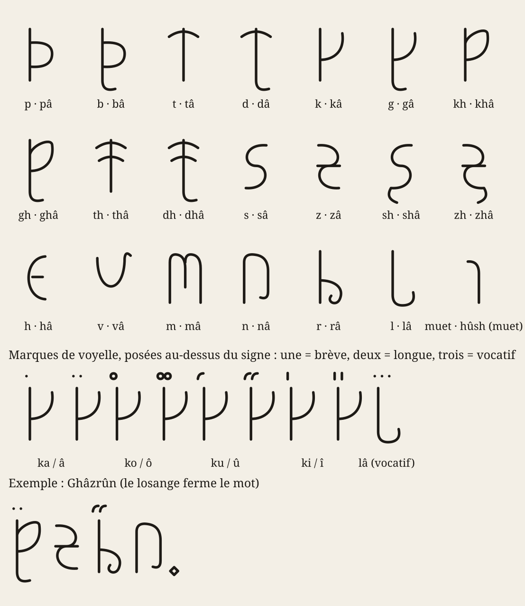

# Les zhâkar : l'écriture gravée du Ghâzrûn



*Table complète dans `alphabet.svg`. Exemple d'inscription dans `exemple-inscription.svg`. Les deux sont produits par `outils/zhakar.py`, qui grave n'importe quel texte romanisé.*

---

## 1. Principe

Les Voix n'écrivent pas : un mot dit suffit. Les **zhâkar** (« marques ») ont été inventés pour les serviteurs et les vassaux, afin que les serments tiennent dans une mémoire mortelle. Un mot gravé est un mot **arrêté à la deuxième profondeur** : il lie, mais il ne fait pas (voir `monde.md`, § 7).

L'écriture est un **abugida carré** :

- **La consonne est l'os du mot** (*ghrôm*). Chaque consonne est un signe plein, inscrit dans un carré, fait uniquement de traits droits : une courbe au burin éclate la pierre.
- **La voyelle est la chair** (*zhamb*). Elle ne s'écrit pas comme une lettre mais comme une **entaille** portée au-dessus de la consonne qu'elle suit.
- **La longueur est le nombre d'entailles** : une entaille pour une brève, deux pour une longue, trois pour le vocatif noble (*thâlâ*, « ô tour »).
- Un mot qui commence par une voyelle (*ûn, ûkh, îsh*) s'appuie sur **le signe muet**, un simple trait vertical nommé *hûsh*, « silence ».

## 2. Les vingt signes

Le système est régulier, ce qui le rend facile à apprendre et lui donne son air de forgerie :

| Famille | Trait commun | Signes |
|---|---|---|
| Occlusives sourdes | un **linteau** (barre haute) | p, t, k |
| Occlusives sonores | le même signe + **barre de base** | b, d, g |
| Fricatives de gorge | l'occlusive **fermée** sur la droite | kh (de k), gh (de g) |
| Dentales | le t avec une **barre médiane** | th, dh |
| Sifflantes | **marches** (s, sh) et **zigzags** (z, zh) ; les chuintantes ajoutent un trait descendant | s, z, sh, zh |
| Souffle | une marche simple | h |
| Nasales | un **portique** ; le m ajoute un pilier central | n, m |
| Liquides | le linteau à **jambe** (r) et l'équerre à **crochet** (l) | r, l |
| Labiale | un creux à fond anguleux | v |

Chaque signe porte un nom : la consonne suivie de *â* (*pâ, tâ, khâ, ghâ…*). Réciter l'alphabet, c'est réciter vingt vocatifs.

## 3. Les entailles de voyelle

| Voyelle | Entaille | Brève | Longue |
|---|---|---|---|
| a / â | trait vertical | ˈ | ˈˈ |
| o / ô | trait horizontal | ‾ | ‾ ‾ |
| u / û | trait oblique | ˋ | ˋˋ |
| i / î | petit carré | ▫ | ▫▫ |

Un signe sans entaille se lit sans voyelle (consonne de groupe ou de fin de mot : *vorz* s'écrit v-o-r-z avec une seule entaille, sur le v).

## 4. Ponctuation

- **Le point** (un petit carré sous la ligne, après le mot) ferme le mot. Il n'y a pas d'espace : la pierre n'en a pas besoin.
- **Le trait horizontal** sépare les vers. Un serment en cinq vers a quatre traits.
- **L'entaille triple** du vocatif est le seul signe ornemental. La graver sur un nom qu'on n'invoque pas est un sacrilège.

## 5. Sens de la gravure

- Sur la pierre et le métal, on grave **de droite à gauche**, « vers la porte » : le Lieur grave face à l'entrée de la salle et finit son serment en regardant le seuil.
- Sur la peau et dans les livres des vassaux, on écrit de gauche à droite. Les Lieurs disent que c'est pour cela que les livres mentent.

L'outil `zhakar.py` rend les deux : par défaut de gauche à droite, avec `--inscription` de droite à gauche.

## 6. Graver un texte

```
python3 outils/zhakar.py "Vorzghan zâraghot" -o serment.svg
python3 outils/zhakar.py "Ô thâlâ, thâl ûlâr\nNôkh dâl thôk slûgôn" --inscription --vocatif thâlâ -o linteau.svg
python3 outils/zhakar.py --alphabet -o alphabet.svg
```

`\n` sépare les vers, `--vocatif` liste les mots qui reçoivent l'entaille triple, `-s` règle la taille.
